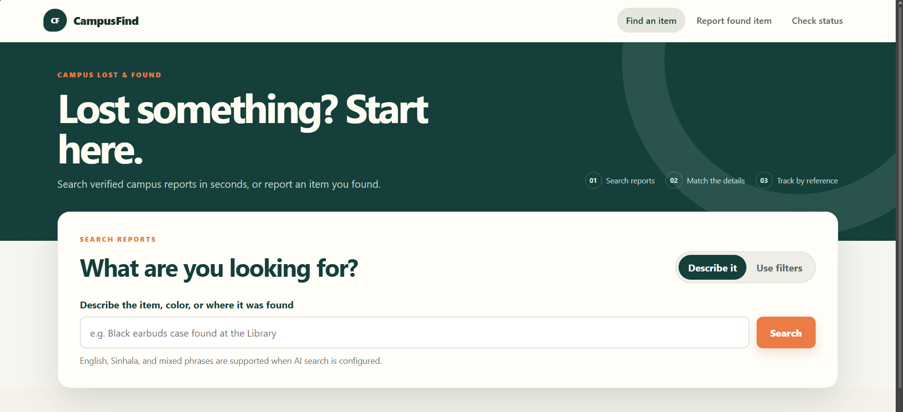
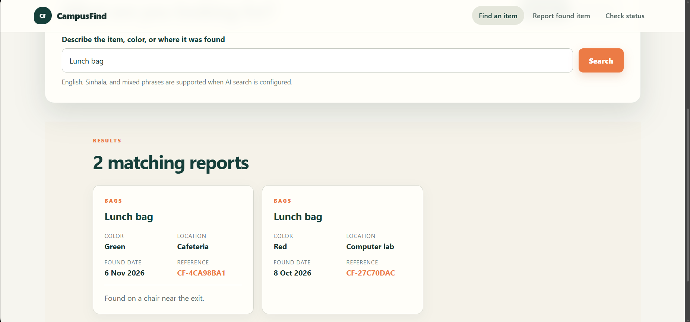
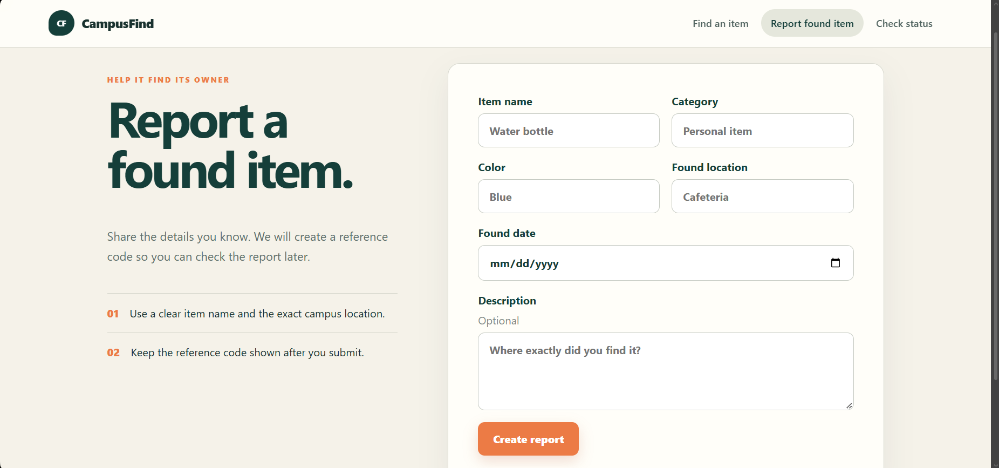
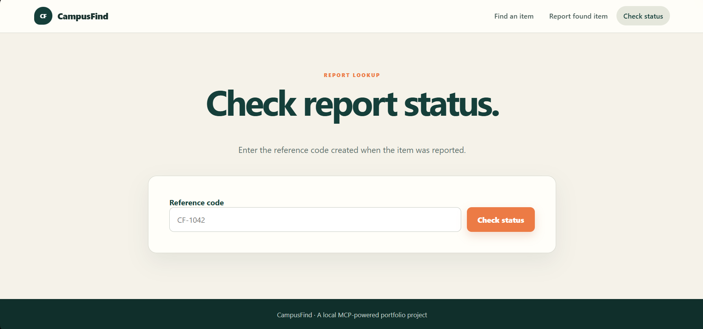

# CampusFind

CampusFind is a local full-stack campus lost-and-found demo. Students can search available items, report a found item, and check a report's status. It is designed as a beginner-friendly AI engineering portfolio project that demonstrates the Model Context Protocol (MCP) without letting an AI model query the database directly.

## Application screenshots

### Find an item



### Search results



### Report a found item



### Check report status



## How the layers work

```text
React UI -> FastAPI -> MCP stdio client -> FastMCP tools -> MySQL
                         ^
Natural-language search -> OpenAI extracts filters only
```

- **React/Vite** renders the three pages and calls the HTTP API.
- **FastAPI** validates HTTP requests and starts a short-lived local MCP session for each request.
- **OpenAI** converts a natural-language search into a validated filter object. It never creates SQL or supplies search results.
- **FastMCP** exposes exactly three tools: `search_found_items`, `report_found_item`, and `get_report_status`.
- **MySQL** is the source of truth. All SQL is parameterized in `items_repository.py`.

The per-request MCP session is intentionally simple for a portfolio demo: FastAPI starts the server with the active Python interpreter, initializes the stdio session, calls one tool, then closes the session and subprocess. A production service could reuse a long-running session.

## 1. Prerequisites

Install Python 3.11 or newer, Node.js 20 or newer, and MySQL 8. Run the commands below from the stated directories.

## 2. Backend setup

In Windows PowerShell, from the repository root:

```powershell
cd backend
py -m venv .venv
.\.venv\Scripts\Activate.ps1
python -m pip install -r requirements.txt
Copy-Item .env.example .env
```

On macOS/Linux, replace the activation and copy commands with:

```bash
source .venv/bin/activate
cp .env.example .env
```

Edit `backend/.env` with your local MySQL values. Natural-language search also needs a valid `OPENAI_API_KEY`. Manual search, report creation, and status lookup do not need an OpenAI key. Never commit the `.env` file.

Example configuration keys:

```dotenv
OPENAI_API_KEY=
OPENAI_MODEL=gpt-4o-mini
MYSQL_HOST=127.0.0.1
MYSQL_PORT=3306
MYSQL_USER=root
MYSQL_PASSWORD=your_mysql_password
MYSQL_DATABASE=campusfind
FRONTEND_ORIGIN=http://localhost:5173
MCP_TIMEOUT_SECONDS=15
```

## 3. Create the database and import the CSV

From the repository root, create the database/table. PowerShell and macOS/Linux use the same MySQL command:

```powershell
mysql -u root -p < database/schema.sql
```

If PowerShell treats input redirection differently in your environment, run this instead:

```powershell
Get-Content database/schema.sql | mysql -u root -p
```

Then, from `backend` with the virtual environment active:

```powershell
python scripts/import_dataset.py
```

The first run should print `Inserted: 20; skipped: 0`. Running it again is safe and should print `Inserted: 0; skipped: 20`. Existing reference codes are skipped and their values are not changed.

## 4. Start the application

Start the API from `backend`:

```powershell
uvicorn app.main:app --reload --port 8000
```

In a second terminal, set up and start the frontend from `frontend`:

```powershell
npm install
Copy-Item .env.example .env
npm run dev
```

On macOS/Linux use `cp .env.example .env`. Open `http://localhost:5173`. API documentation is at `http://localhost:8000/docs` and the health check is at `http://localhost:8000/health`.

## 5. Use the three pages

- **Find an Item (`/`)**: use manual filters without an OpenAI key, or describe the item in natural language when the key is configured.
- **Report a Found Item (`/report`)**: submit the form and save the new `CF-...` reference code.
- **Check Report Status (`/status`)**: look up an available or returned report by its reference code.

Useful seeded demonstrations:

- Manual filters `Earbuds case`, `Black`, and `Library` return `CF-1042`.
- `CF-1042` is available.
- `CF-1043` is returned.
- `CF-9999` returns a clear not-found response.

## 6. Inspect the MCP server directly

With backend dependencies installed and `backend/.env` configured, run this from `backend`:

```powershell
npx @modelcontextprotocol/inspector python -m campusfind_mcp.server
```

In Inspector, choose **Tools** and select **List Tools**. You will see:

1. `search_found_items` — try `item_name: Earbuds case`, `color: Black`, `found_location: Library`.
2. `report_found_item` — provide all required fields and a `YYYY-MM-DD` date.
3. `get_report_status` — try `reference_code: CF-1042`.

The MCP server keeps stdout for protocol messages. Its diagnostic logs go to stderr.

## 7. HTTP examples without OpenAI

From any PowerShell directory while FastAPI is running:

```powershell
$body = @{ filters = @{ item_name = 'Earbuds case'; color = 'Black'; found_location = 'Library' } } | ConvertTo-Json
Invoke-RestMethod -Method Post -Uri http://localhost:8000/api/items/search -ContentType application/json -Body $body

$report = @{ item_name = 'Notebook'; category = 'Stationery'; color = 'Blue'; found_location = 'Library'; found_date = '2026-11-12'; description = 'Near the front desk' } | ConvertTo-Json
Invoke-RestMethod -Method Post -Uri http://localhost:8000/api/items -ContentType application/json -Body $report

Invoke-RestMethod http://localhost:8000/api/items/CF-1042
```

Use today's date or an earlier date when creating a report. The server compares dates using the Asia/Colombo timezone.

## Natural-language request flow

For a query such as “Library එකේ කළු earbuds case එකක් හම්බවුණාද?”:

1. React sends `{ "query": "..." }` to FastAPI.
2. The OpenAI SDK extracts only `item_name`, `color`, and `found_location` into a Pydantic schema.
3. FastAPI validates the filters and sends them to `search_found_items` through local MCP stdio.
4. The MCP tool calls parameterized repository SQL.
5. MySQL returns the matching rows, and the result travels back through MCP, FastAPI, and React.

The model never generates SQL and never invents result records. If OpenAI is unavailable, the UI explains that manual search remains available. The parser follows the official [OpenAI Structured Outputs guide](https://developers.openai.com/api/docs/guides/structured-outputs).

## Short interview demo

1. Show the architecture above and emphasize that FastAPI accesses item data only through MCP.
2. Search manually for the black Library earbuds case and open `CF-1042`.
3. Show `CF-1043` to demonstrate the returned state.
4. Create a new report, copy its generated reference code, search for it, then look it up on the status page.
5. If an OpenAI key is configured, repeat the first search with a mixed Sinhala-English sentence and explain structured filter extraction.

## Files to read first

1. `backend/campusfind_mcp/server.py` — the three MCP tools and direct tool validation.
2. `backend/app/services/mcp_client.py` — the local stdio client lifecycle.
3. `backend/campusfind_mcp/items_repository.py` — parameterized MySQL queries.
4. `backend/app/routes/items.py` — the HTTP-to-MCP boundary.
5. `backend/app/services/search_parser.py` — OpenAI structured filter extraction.
